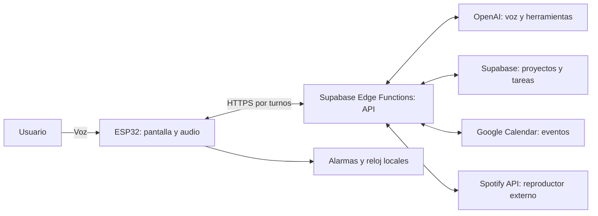

# Plan de implementación del asistente ESP32

Fecha: 9 de octubre de 2026. Versión 3: Supabase como API intermediaria, español y voz económica por defecto. El usuario autorizó usar el proyecto Supabase existente, con tablas ESP32 separadas de Pomodoro. Las decisiones y etapas originales se conservan; el estado real de implementación se registra al final de este documento.

## 1. Decisiones confirmadas y recomendaciones

El usuario confirmó la placa Waveshare ESP32-S3-RLCD-4.2 (N16R8, ES7210, ES8311, SHTC3, PCF85063, KEY y parlante externo), el calendario de escritura franrojas331@gmail.com y el uso del proyecto Supabase existente con tablas separadas.

Confirmado: Supabase para proyectos y tareas, preferencia inicial por Whisper para transcripción y Spotify API para música. OpenAI deprecó Whisper el 26 de agosto de 2026 y anunció su retiro para el 26 de febrero de 2027; para una integración nueva se recomienda gpt-transcribe. Home Assistant queda fuera del alcance actual. Google Calendar y creación por voz permanecen en el alcance original. Se elige Supabase Edge Functions como intermediario del primer alcance y español (es-AR) como idioma. Respuesta hablada y presupuesto inferior a US$5 mensuales confirmados; falta elegir modelo de interpretación, voz y aplicar el control de gasto. La conversación fluida será una función opcional, apagada por defecto.

| Área | Decisión | Motivo |
| --- | --- | --- |
| Papel del ESP32 | Terminal de voz, pantalla y ejecución local de alarmas | Mantener el trabajo pesado y las credenciales de proveedores en un servidor |
| Conectividad | HTTPS hacia Supabase Edge Functions; sincronización cada 5 minutos | Consultas inmediatas ante acciones; sin conexión permanente en modo económico |
| Almacenamiento local | SD confirmada para copia de datos, audios y recursos; memoria interna para alarmas/configuración | Mostrar datos locales entre consultas y reducir solicitudes repetidas |
| Proyectos y tareas | Proyecto de Supabase elegido por el usuario; creación por voz | Permitir horas, estados, prioridades, recordatorios y futuras rutinas propias |
| Calendario | Google Calendar como registro principal de eventos | Mantener la agenda existente y sus cambios desde otros dispositivos |
| Alarmas | Configuración persistente y programación local | Sonar aunque se caigan Internet o el servidor, mientras haya energía y hora válida |
| IA inicial | Audio → transcripción → modelo con herramientas → respuesta hablada | Facilitar diagnóstico, control de operaciones y medición del resultado |
| IA conversacional | Función opcional desactivada por defecto, con sesión acotada | Controlar costo; validar transporte, eco e interrupciones antes de habilitar |
| Domótica | Fuera del alcance actual | Sin dispositivos conectados; no crear adaptador ni dependencias |
| Música inicial | Spotify API para estado y controles por Wi-Fi | Reproductor externo; destino por elegir |
| Interfaz | Conservar las ocho vistas y convertir su contenido en datos dinámicos | Aprovechar el diseño existente |
| Framework inicial | Mantener Arduino/PlatformIO para las primeras etapas | Migrar a ESP-IDF sólo si una prueba de audio justifica el cambio y verifica compatibilidad |

Las decisiones confirmadas fijan el alcance; las restantes son recomendaciones sujetas a información pendiente y pruebas de hardware.

## 2. Punto de partida comprobado

La base `ESP32-MIC-AI` contiene inicio, alarmas, tareas, calendario, música, escucha, respuesta y reposo. El firmware muestra mapas de bits de demostración; todavía no captura voz, reproduce sonido, consulta servicios ni configura navegación táctil. La hora también es de ejemplo.

La configuración apunta a ESP32-S3 N16R8, 16 MB de flash y 8 MB de PSRAM, con RLCD monocromática de 400 × 300 en orientación horizontal. Las bibliotecas del fabricante incluyen ejemplos de ES8311/ES7210, reloj PCF85063, SHTC3 y almacenamiento en tarjeta. Son referencias útiles, pero hay que comprobar la revisión de la placa y el circuito de audio realmente conectado antes de programarlos.

El diseño debe reemplazar el texto incrustado en imágenes por campos dibujados en tiempo de ejecución. Los fondos, iconos y mascota pueden seguir siendo recursos gráficos. La navegación física se resolverá con los botones realmente disponibles y voz; el gesto táctil de la vista de PC no demuestra que la placa tenga entrada táctil.

Referencias: documentación local de [pantallas](screen/README.md), [módulos](modules/README.md) y [configuración](modules/build-upload.md); [placa Waveshare](https://docs.waveshare.com/ESP32-S3-RLCD-4.2).

## 3. Arquitectura y alternativas

El ESP32 recibe estructuras pequeñas y reproduce audio por bloques. El servidor transforma las respuestas de cada proveedor al formato común del dispositivo, interpreta solicitudes y ejecuta operaciones verificadas. Supabase aporta la base y, mediante Edge Functions, la API que llama proveedores y ejecuta acciones. Whisper y los modelos se consumen como servicios externos; no se ejecutan dentro del ESP32 ni como modelos locales en la base.

| Alternativa | Ventaja | Inconveniente | Uso propuesto |
| --- | --- | --- | --- |
| Servicio local en PC/mini PC/NAS | Entorno de pruebas y eventual control de la PC | Equipo encendido y mantenimiento | Alternativa para el prototipo |
| Servicio en nube | Disponibilidad sin depender de la PC personal | Alojamiento y costos de uso | Recomendado para uso cotidiano con el alcance actual |
| ESP32 conectado directamente a todas las APIs | Menos componentes iniciales | Acopla OAuth, reconexiones, formatos y secretos al firmware | Descartada para el alcance completo |

Decisión v3: usar Supabase Edge Functions como servicio intermediario del primer alcance. El ESP32 envía peticiones breves de voz/acciones; las funciones llaman a Whisper, interpretación, síntesis y APIs autorizadas, y consultan la base. Esto evita exigir un servidor separado inicialmente. Para conversación continua, comprobar duración máxima, reconexión y latencia antes de elegir un relay persistente. Las Edge Functions soportan WebSocket, pero mantienen límites de ejecución: no prometer una sesión ilimitada. Fuentes: [Edge Functions](https://supabase.com/docs/guides/functions), [límites](https://supabase.com/docs/guides/functions/limits), [WebSockets](https://supabase.com/docs/guides/functions/websockets).

La conexión a Google se autoriza una vez desde un navegador; el servidor conserva y renueva los tokens. El dispositivo usa una identidad propia vinculada al dueño. Las claves de OpenAI, tokens de Google y secretos de Supabase se mantienen en el servidor. Si se expone la base a clientes, configurar permisos de API y políticas RLS por propietario. No incluir `service_role` en el firmware. Fuentes: [OAuth de Google](https://developers.google.com/identity/protocols/oauth2/web-server), [RLS de Supabase](https://supabase.com/docs/guides/database/postgres/row-level-security).

## 4. Tareas, eventos y recordatorios

Una tarea es algo que hay que completar; un evento ocupa un intervalo de la agenda; un recordatorio avisa; una alarma del dispositivo suena según su configuración. No convertir automáticamente cada tarea en un evento.

| Opción para tareas | Cuándo sirve | Limitación | Decisión |
| --- | --- | --- | --- |
| Supabase | Proyectos y tareas con horarios, prioridades y reglas | Hay que desarrollar la lógica y las vistas | Confirmada por el usuario |
| Google Tasks | Listas sencillas aprovechando la interfaz de Google | La API conserva el día, pero no permite leer ni escribir la hora programada | Alternativa si alcanza con tareas por día |
| Eventos en Google Calendar | Reservar tiempo para una actividad | El modelo de evento no trae el ciclo de completar una tarea | Sólo para bloques de trabajo explícitos |

La limitación horaria de Google Tasks está documentada en su [recurso tasks](https://developers.google.com/workspace/tasks/reference/rest/v1/tasks). No equiparar lo que muestra la aplicación de Google con lo que expone su API.

Flujos propuestos:

- “Agregá comprar leche”: tarea sin fecha en Supabase.
- “Recordame llamar a mamá mañana a las 14”: tarea con aviso a una hora concreta. Si hace falta distinguir vencimiento de aviso, la IA pregunta una sola vez.
- “Marcá comprar leche como hecha”: completar la tarea identificada; si hay dos similares, pedir cuál.
- “Reservá media hora mañana para estudiar”: evento en Google Calendar; sólo vincularlo a una tarea si se pidió.
- “Pasá la reunión a las 16”: actualizar el evento identificado, sin duplicarlo.

Supabase es el dueño de las tareas y Google el dueño de los eventos. Un vínculo opcional `calendar_event_id` relaciona una tarea con un bloque de agenda. El primer alcance no incorpora sincronización bidireccional con Google Tasks, porque introduciría conflictos entre dos registros de la misma tarea.

Las tareas se crean por voz. La pantalla sirve para consultarlas, abrirlas y completarlas mediante voz o controles disponibles. No se construye una aplicación de carga; una página mínima de vinculación de cuentas sí puede ser necesaria.

El proyecto de Supabase contiene la base de datos. Propuesta pendiente de confirmar: dentro de esa base, `projects` representa tus proyectos personales y `tasks.project_id` vincula las tareas. Si por “proyectos” te referís únicamente al proyecto técnico de Supabase, la agrupación personal se puede omitir. No crear una instancia de Supabase por cada proyecto personal.

Antes de diseñar migraciones hay que inspeccionar y reutilizar el esquema existente, si corresponde. Proyecto identificado por el usuario: jlravhhuzpodggjjspwk, nombre pomodoro. No hay tareas iniciales; no insertar ejemplos. Propuesta para voz: “Agregá revisar el micrófono al proyecto ESP32”; sin proyecto indicado, usar “Bandeja de entrada”. Ante un nombre ambiguo, pedir aclaración. La creación y el archivo de proyectos por voz quedan como ampliación; no crear proyectos nuevos automáticamente por un error de transcripción.

## 5. Alarmas locales y funcionamiento sin red

Guardar en memoria persistente: identificador, etiqueta, hora local, días de semana, zona horaria, habilitación, sonido y duración de posposición. Permitir “todos los martes a las 7”, días laborables y alarmas de una sola fecha.

El dispositivo programa la próxima ocurrencia y confirma una modificación sólo después de guardarla. Una orden desde el servidor debe recibir confirmación de la placa; si está desconectada, queda pendiente y no se anuncia como instalada. Al reconectar, consultar la versión local antes de aplicar cambios.

Usar hora de red cuando esté disponible y el RTC como respaldo, comprobando su validez. Zona inicial: `America/Argentina/Buenos_Aires`. Definir el manejo de cambios de zona y reloj; guardar la última ocurrencia disparada para no sonar dos veces tras una corrección de hora. Tras reinicio, conservar la rutina. Una alarma vencida durante apagado se muestra como perdida; no reproducir todas las alarmas atrasadas de golpe.

Sin Internet pueden funcionar alarmas ya guardadas, reloj válido, navegación, sonido local y datos almacenados. La voz libre en nube no puede crear nuevas tareas sin red: se muestra el fallo. Un reconocimiento local de órdenes muy limitadas sería una etapa posterior, sujeto a soporte del modelo e idioma. “Reposo” sigue siendo visual; no activar deep sleep sin asegurar despertar para alarmas e interacción.

## 6. IA, voz y acciones

### Modo económico y conversación fluida opcional

Actualización: el usuario confirma síntesis y respuesta hablada en español y fija un presupuesto inferior a US$5 al mes. Proponer un límite operativo de US$4 mensuales de llamadas externas, dejando margen; no prometer que impuestos, conversión de moneda o una suscripción de Spotify entren en ese monto. Tomar el límite como costo adicional del asistente, y revisar si debe incluir servicios ya contratados.

Para ese presupuesto, comenzar con Supabase Free dentro de sus cuotas; el plan Pro empieza en US$25 al mes y no encaja en un total inferior a US$5. Confirmar el plan real del proyecto. Free puede pausarse tras inactividad y no ofrece las mismas garantías de disponibilidad; las alarmas locales permanecen independientes. Fuente: [precios de Supabase](https://supabase.com/pricing).

Whisper cuesta US$0,006 por minuto según la tarifa consultada. Ejemplo de cálculo, no garantía de gasto total: 300 órdenes al mes de 10 segundos suman 50 minutos, US$0,30 de transcripción; faltan interpretación, síntesis y reintentos. Elegir el modelo de voz vigente tras una prueba, mantener respuestas breves y reutilizar audios fijos para avisos frecuentes. Fuente: [Whisper](https://developers.openai.com/api/docs/models/whisper-1).

El límite mensual se registra en `esp32_device_settings.monthly_budget_usd`. La API debe verificar y reservar costo antes de cada llamada, cerrar reservas al terminar y bloquear nuevas llamadas que agoten el saldo. No basta con un tope diario ni un aviso de consumo. Con saldo agotado siguen funcionando reloj, alarmas y consulta de datos sin IA. La conversación fluida comparte el mismo presupuesto y no lo puede sobrepasar por estar activada.

### Activación por aplausos: prueba opcional local

Propuesta: dos aplausos reconocidos localmente habilitan una captura breve. Emitir un tono local, mostrar “Escuchando” y enviar a Whisper sólo si después se detecta habla. Si no hay voz, salir sin llamada a la nube. Un aplauso no identifica al usuario ni autoriza operaciones por sí mismo.

El detector de aplausos debe implementarse y calibrarse en la placa; no tratar VAD como un detector de aplausos. Probar golpes, música, TV, distancias y falsos positivos. Desactivarlo durante respuestas del parlante/sonido de alarma y limitar activaciones consecutivas. Mantener botón como respaldo. La detección local evita cargos de API por esperar el aplauso, pero usa micrófono, CPU y energía continuamente. Espressif ofrece VAD y procesamiento de eco como componentes de audio; la compatibilidad con el firmware actual requiere validación. Fuente: [ESP-SR AFE](https://docs.espressif.com/projects/esp-sr/en/latest/esp32/audio_front_end/README.html).

La configuración añade `activation_method` (`button` o `double_clap`); se conserva `button` por defecto hasta superar las pruebas. No se implementó todavía el detector.

### Acceso a Google Calendar

El usuario indica que conectó Google Calendar en esta conversación. En esta sesión no se expusieron herramientas de ese conector: no se pudo comprobar el calendario ni sus permisos. Una conexión del chat permite las operaciones que exponga el conector; no entrega automáticamente credenciales OAuth a las Edge Functions del dispositivo. La vinculación del backend sigue pendiente, junto con seleccionar el calendario de escritura. No se crearon eventos.

Idioma confirmado: español, variante inicial es-AR. Los textos de interfaz, instrucciones, transcripción y respuesta hablada se preparan en español.

- Modo económico por defecto: pulsar para hablar, una frase de hasta 30 segundos, Whisper, interpretación con herramientas y respuesta breve. Fuera de la interacción no enviar audio ni mantener una sesión de voz facturable. Consultar tareas/agenda y controlar Spotify con sus APIs no debe invocar IA salvo que haya una orden de voz que interpretar.
- Conversación fluida: interruptor explícito, desactivado por defecto. Propuesta de sesión inicial máxima de 3 minutos, salida al pedir detener o alcanzar el tiempo, e indicador visible. Fluidez no significa respuesta instantánea garantizada: medir red, procesamiento y eco.
- La voz fluida puede usar otro servicio de audio distinto de Whisper; elegirlo después de comparar costo y calidad. Whisper queda como componente del modo por turnos, no como requisito que se deba duplicar en cada turno de un modelo nativo de audio.
- Guardar límites y modo en `esp32_device_settings`; registrar uso en `esp32_ai_usage`. El límite mensual propuesto es US$4; un tope diario adicional es opcional. Para imponerlo, la API debe reservar/verificar saldo antes de iniciar llamadas, no sólo sumar estimaciones después. Los campos de la base por sí solos no cobran ni frenan solicitudes.

Whisper sigue teniendo costo de uso. El modo económico reduce llamadas y duración; no implica costo cero ni captura permanente gratuita. Alarmas locales y navegación no requieren llamadas al modelo.

Whisper transcribe audio; la interpretación y las acciones requieren un modelo y herramientas adicionales. La ruta inicial propuesta es pulsar para hablar, capturar una frase, transcribir con `whisper-1` (Whisper confirmado), interpretar mediante OpenAI, ejecutar la herramienta y sintetizar una respuesta breve. Fuentes: [transcripción](https://developers.openai.com/api/docs/guides/speech-to-text), [herramientas](https://developers.openai.com/api/docs/guides/function-calling).

Para conversación fluida, evaluar GPT-Live y Realtime con pruebas sobre la misma placa y red. La documentación actual presenta GPT-Live para nuevas experiencias conversacionales; Realtime mantiene su propio modelo de sesiones y herramientas. Mantener un adaptador para no ligar la interfaz a un único proveedor de voz. Fuente: [audio y voz de OpenAI](https://developers.openai.com/api/docs/guides/audio).

Codex puede integrarse mediante SDK/app-server desde un equipo o servidor. Propuesta: reservarlo para acciones de ingeniería o del equipo, si se necesitan; la primera versión usa herramientas concretas para agenda, tareas y alarmas. No hay motivo para exigir una sesión de Codex por cada alarma. Fuente: [Codex SDK](https://learn.chatgpt.com/docs/codex-sdk).

| Función | Viabilidad y condición |
| --- | --- |
| Crear, completar y reprogramar tareas | Sí, con el adaptador de tareas |
| Consultar, crear y mover eventos | Sí, con cuenta y calendario autorizados |
| Crear y posponer alarmas | Sí, con confirmación del guardado local |
| Resumir el día y conversar con contexto | Sí; consultar datos actuales y conservar contexto breve |
| Abrir una vista del ESP32 | Sí, herramienta local de navegación |
| Abrir una aplicación o página en la PC | Requiere un agente instalado y activo en esa PC |
| Controlar cualquier app sin integración | No se garantiza; cada equipo necesita herramientas o automatización propia |
| Hablar y escuchar simultáneamente | Etapa posterior: medir cancelación de eco y calidad de interrupción |
| Conversación libre sin Internet en el ESP32 | Fuera del alcance inicial |
| Hablar por iniciativa propia | Resumen o aviso configurado, con horario de silencio; no comentarios permanentes |

Para el primer audio, priorizar turnos: durante la respuesta se suspende o filtra la captura para evitar que el asistente se escuche a sí mismo. Dos micrófonos ayudan sólo si el hardware, los canales y el procesamiento están configurados correctamente. Prioridad de sonido: alarma, interacción del asistente, música local. La pausa de música externa depende del reproductor conectado.

La IA aclara fechas o destinatarios ambiguos y confirma operaciones destructivas o de impacto. Para acciones habituales inequívocas, ejecuta y comunica el resultado. Nunca decir “creado” si el servicio rechazó la escritura; cada operación tiene identificador para evitar duplicados al reintentar. No guardar audio crudo por defecto; limitar historial y consumo por sesión.

## 7. Música: Spotify confirmado y alternativas fuera del primer alcance

El primer alcance incluye Spotify API. YouTube, receptor Bluetooth externo y audio musical local son ampliaciones opcionales; no bloquean las tareas, el calendario ni la integración de Spotify.

Separar título/progreso, controles y transporte del sonido. Saber qué se reproduce no implica que el sonido salga por el ESP32.

| Alternativa | Qué permite | Inconveniente | Prioridad |
| --- | --- | --- | --- |
| Spotify API + reproductor externo | Mostrar pista, progreso y controlar un cliente autorizado | OAuth, permisos, límites y cliente compatible; reproducción requiere Premium | Primera opción para Spotify |
| Agente en PC o puente en teléfono | Informar reproducción de Spotify/YouTube y recibir órdenes | Desarrollo y permisos específicos del sistema; datos variables | Evaluar para YouTube |
| Receptor Bluetooth A2DP externo | Escuchar el audio del teléfono en el dispositivo | Hardware, alimentación y mezcla de audio; metadatos dependen de AVRCP | Sólo si el parlante del ESP32 es requisito |
| Tarjeta SD o radio/stream autorizado | Audio reproducido directamente por la placa | No equivale a Spotify/YouTube | Prueba de audio y alternativa local |
| Spotify/YouTube completos directamente en el S3 | Pretender un cliente autónomo | No hay una ruta simple garantizada mediante sus APIs públicas | Fuera del primer alcance |

El S3 soporta Bluetooth LE, pero no Bluetooth Classic; A2DP convencional requiere hardware adicional. BLE por sí solo no lo transforma en un parlante Bluetooth de teléfono. Fuente: [tabla de chips de Espressif](https://docs.espressif.com/projects/esp-idf/en/latest/esp32c3/api-guides/bt-architecture/overview.html).

Spotify expone estado de reproducción, pista y progreso; la Web API controla clientes, no entrega el flujo de audio al ESP32. Start/Resume requiere Premium. El acceso de desarrollo tiene restricciones de cuenta, usuarios y endpoints, por lo que se valida la app concreta antes de comprometer controles. Fuentes: [estado](https://developer.spotify.com/documentation/web-api/reference/get-information-about-the-users-current-playback), [reproducción](https://developer.spotify.com/documentation/web-api/reference/start-a-users-playback), [acceso de desarrollo](https://developer.spotify.com/blog/2026-02-06-update-on-developer-access-and-platform-security).

Para YouTube, usar el reproductor oficial en teléfono/PC y un puente que reporte su estado si la plataforma lo permite. La API de YouTube no es una fuente de audio separado; sus políticas prohíben aislar audio del video y ciertas formas de reproducción en segundo plano en clientes API. No diseñar la solución alrededor de extraer MP3. Fuente: [políticas de YouTube](https://developers.google.com/youtube/terms/developer-policies-guide).

La primera vista de música muestra fuente, título, artista, duración, progreso y destino, por ejemplo “Sonando en PC”. Sólo habilita botones que el adaptador declara disponibles. Sin datos recientes, muestra “estado desactualizado”; no inventa una canción. El progreso se estima desde la última lectura y se corrige con la siguiente; pausar, buscar y cambiar pista reinician esa estimación. Un historial opcional guarda intervalos observados y marca lagunas de conexión, sin prometer un historial exacto de toda la escucha.

## 8. Boceto funcional de las ocho vistas

| Vista | Cómo queda | Estados o acciones necesarios |
| --- | --- | --- |
| Inicio | Mascota, hora/fecha reales, próxima alarma y cantidad de pendientes | Conexión, siguiente evento; temperatura/humedad sólo con lectura válida |
| Alarmas | “07:00 · Rutina · martes”, habilitación y próxima ocurrencia | Guardando, activa, sonando, pospuesta, error de reloj |
| Tareas | Cuatro filas por página con título, fecha/aviso y casilla | Pendiente, completada, sin tareas, sincronizando, sin conexión |
| Calendario | Mes y día seleccionado; lista con horas | Día sin eventos, agenda almacenada, cambios pendientes; importantes por regla propia |
| Música | Portada adaptada a monocromo, pista, progreso y destino | Sin reproductor, pausada, controles disponibles, datos desactualizados |
| Escucha | Micrófono y frase detectada | Conectando, escuchando, procesando, necesita aclaración, cancelada |
| Respuesta | Confirmación breve y botón/orden de detener | Hablando, éxito, operación pendiente, fallo; opción de volver a escuchar |
| Reposo | Mascota y hora real | Salir con botón/voz admitida; alarma interrumpe el reposo |

En 400 × 300, evitar textos extensos: paginar tareas y respuestas. Conservar el calendario mensual y las columnas originales si la lectura física es suficiente; si queda pequeño, seleccionar una columna/día y mostrar una lista ampliada. No depender sólo de animaciones para comunicar estados.

## 9. Estructuras e interfaces propuestas

### Tablas iniciales autorizadas

Destino: `jlravhhuzpodggjjspwk`, llamado pomodoro según el usuario. Usar prefijo `esp32_` para distinguir este módulo sin renombrar el proyecto. No insertar tareas, cuentas ni credenciales de muestra.

| Tabla | Finalidad |
| --- | --- |
| `esp32_projects` | Agrupar tareas personales, si se usa esa organización |
| `esp32_tasks` | Títulos, estados, fechas y recordatorios |
| `esp32_devices` | Dispositivos vinculados a un propietario |
| `esp32_device_settings` | Español, zona, modo de voz y límites configurables |
| `esp32_reminders` | Trabajos de aviso y estado de entrega |
| `esp32_commands` | Órdenes, identificadores de reintento y resultados |
| `esp32_ai_usage` | Consumo y estimaciones por llamada; no audio crudo |

El esquema define RLS y lectura por propietario. Las escrituras se realizan mediante funciones de servidor que validan la identidad y acción; no se conceden escrituras directas al cliente. Vincular usuario/dispositivo es una etapa pendiente: no crear un usuario ficticio ni publicar secretos en la placa. Alarmas permanecen locales; Google Calendar no se replica como otro registro principal y Spotify no requiere una tabla de canciones.

El archivo SQL es una propuesta ejecutable. Falta inspeccionar el esquema remoto antes de aplicar para evitar conflictos; luego verificar tablas, restricciones, permisos y aislamiento entre usuarios. Jobs, emparejamiento, presupuesto y llamadas a proveedores todavía requieren funciones: crear tablas no implementa esas conductas.

Contrato v1: esquema inicial preparado en [database/initial-schema.sql](database/initial-schema.sql). Tablas autorizadas por el usuario, todavía no aplicadas ni verificadas remotamente por fallo del conector. Endpoints y firmware siguen sin implementar.

| Estructura | Campos mínimos |
| --- | --- |
| `Project` | `id`, `owner_id`, `name`, `status`, `created_at`, `updated_at`, `revision` |
| `Task` | `id`, `owner_id`, `project_id`, `title`, `notes`, `status`, `due_date?`, `due_at?`, `remind_at?`, `timezone`, `priority`, `completed_at?`, `calendar_event_id?`, `revision` |
| `CalendarEvent` | `provider_id`, `calendar_id`, `title`, `all_day`, `start_at/end_at` o `start_date/end_date`, `timezone`, `location?`, `etag`, `cancelled` |
| `Alarm` | `id`, `label`, `local_time`, `weekdays` o `one_shot_date`, `timezone`, `enabled`, `snooze_minutes`, `sound_id`, `revision`, `last_fired_occurrence` |
| `PlaybackState` | `source`, `player_id`, `title?`, `artist?`, `duration_ms?`, `position_ms?`, `is_playing`, `observed_at`, `capabilities`, `destination` |
| `AssistantSession` | `session_id`, `device_id`, `state`, `transcript?`, `pending_action?`, `result?`, `expires_at` |
| `Command` | `request_id`, `device_id`, `action`, `arguments`, `expected_revision?`, `expires_at`, `status` |
| `DeviceSnapshot` | `schema_version`, `revision`, `server_time`, `clock_valid`, resumen de tareas/eventos/alarmas/música y estado de sincronización |

No usar una fecha a medianoche para inventar la hora de una tarea. Instantes con zona conocida se normalizan a UTC; días completos conservan fechas. El dispositivo conserva únicamente datos acotados para las vistas y alarmas, no toda la base o agenda.

| Interfaz | Responsabilidad |
| --- | --- |
| `TaskRepository` | listar, crear, completar y reprogramar; reemplazable por Supabase o Google Tasks |
| `CalendarProvider` | consultar intervalos, crear y actualizar eventos; resolver duplicados |
| `AlarmStore` / `AlarmScheduler` | persistir configuración y disparar ocurrencias localmente |
| `SpeechInput` / `SpeechOutput` | captura por bloques, transcripción/síntesis y cancelación |
| `AssistantOrchestrator` | mantener contexto, resolver intención y solicitar herramientas |
| `DesktopAdapter` | abrir aplicaciones/URLs autorizadas en un equipo identificado |
| `MusicAdapter` | leer estado y ejecutar sólo las capacidades disponibles |
| `SyncService` | reconexión, versión, datos completos y cambios incrementales |
| `ViewModel` / `Navigator` | preparar contenido y navegación sin llamadas de red dentro del dibujo |

API lógica propuesta en Edge Functions: snapshot del dispositivo, comandos, estado de comandos, confirmaciones de alarmas y voice-turn. Los nombres/rutas definitivos se fijan al desplegar las funciones. No depender de un WebSocket permanente en modo económico. La voz usa carga acotada para el primer alcance y streaming después. Eventos con `event_id`, `revision` y `request_id`; reconexión obtiene un snapshot nuevo. No introducir MQTT ni dependencias de domótica en esta etapa.

Herramientas de IA: `create_task`, `complete_task`, `reschedule_task`, `list_events`, `create_event`, `update_event`, `set_alarm`, `snooze_alarm`, `open_view`, `control_music` y, después, `open_on_desktop`. La IA produce argumentos; el servidor comprueba dueño, permisos y campos antes de ejecutarlos.

## 10. Sincronización y fallos

### SD y sincronización periódica: decisión incorporada

El usuario confirma una SD conectada y pide incorporar el uso local al plan. Falta verificar capacidad, formato, bus/pines y funcionamiento simultáneo con pantalla/audio. No se implementó todavía lectura o escritura de la tarjeta.

| Almacenamiento | Responsabilidad |
| --- | --- |
| Supabase | Registro principal de tareas; resultados persistentes de operaciones |
| Google Calendar | Registro principal de eventos |
| SD | Copia acotada de tareas/agenda descargadas, audios reutilizables y recursos gráficos |
| Memoria interna | Alarmas, configuración y cola acotada de cambios pendientes |

La copia local conserva versión, fecha de última actualización y rango de agenda descargado. Mostrar “última actualización” y estado sin conexión; no presentar datos almacenados como recién consultados. Si falta o falla la SD, continuar con datos acotados en RAM y mantener alarmas/configuración internas. Actualizar archivos de forma recuperable tras interrupción y no escribir en cada dibujo de pantalla.

| Situación | Política de conexión propuesta |
| --- | --- |
| Reposo con red disponible | Consultar cambios cada 5 minutos; actualizar copia sólo cuando haya cambios |
| Abrir tareas/calendario | Mostrar copia inmediatamente; consultar si está desactualizada o se pide actualizar |
| Crear/completar/reprogramar por voz | Solicitud inmediata; actualizar vista con el resultado real, sin esperar 5 minutos |
| Cambio manual sin red, como completar una tarea | Guardar pendiente localmente y enviar al reconectar; distinguir pendiente de confirmado |
| Hablar con la IA | Conectar sólo durante esa interacción; sin audio continuo hacia la nube |
| Música visible | Consultas más frecuentes según límites del proveedor; estimar progreso localmente |
| Música en reposo | Detener consultas de estado de música; conservar controles bajo demanda |
| Alarmas guardadas | Ejecución local sin consulta al servidor |
| Red caída | Reintentos espaciados; sincronizar al reconectar y resolver versiones |

Una modificación externa puede tardar hasta cinco minutos en verse mientras haya red y el servicio esté disponible. Ese intervalo no garantiza actualización si falla la conexión. Sincronizar datos no invoca Whisper ni el modelo de interpretación. Cachear respuestas/avisos fijos reduce generación de voz repetida, pero no elimina el costo de nuevas respuestas dinámicas.

Los recordatorios próximos pueden descargarse y programarse localmente con identificador y versión; incorporarlo como alcance propuesto de P4. No confundirlos con alarmas: si una tarea se completa o se reprograma desde otro equipo, el aviso local puede quedar desactualizado hasta sincronizar. Deduplicar por ocurrencia y no disparar de nuevo el mismo aviso al recibir la confirmación del servidor. Mostrar recordatorios fuera del rango descargado como no disponibles offline. Antes de habilitarlo, definir ese rango y verificar el reloj.

La SD no habilita transcripción libre sin Internet, escritura offline en Google ni reproducción offline de Spotify. No guardar audio crudo por defecto ni credenciales de proveedores en la tarjeta.

Supabase puede informar cambios, pero tras una desconexión se consulta el estado persistente: una notificación no es una garantía de entrega. El servidor mantiene trabajos durables para recordatorios y comandos pendientes, con vencimiento e idempotencia. Una tarea completada antes de su aviso cancela el trabajo; modificar la hora sustituye su programación. Un aviso pendiente al reconectar se muestra como perdido o vencido según su política, no se trata como alarma local.

Google Calendar conserva su cursor de sincronización en el servidor; al invalidarse, reconstruir el estado. Manejar eventos borrados, recurrentes, de día completo y cambios hechos desde el teléfono. Fuente: [sincronización de Calendar](https://developers.google.com/workspace/calendar/api/guides/sync).

El firmware separa pantalla, audio, alarmas y red con colas y tiempos máximos. La caída de un proveedor no bloquea el reloj ni la alarma. Al cancelar una conversación se invalidan respuestas tardías; una herramienta ya ejecutada debe reportar su resultado real, no fingir que la cancelación deshizo la operación.

## 11. Etapas y tarjetas propuestas

| Tarjeta | Entregable futuro | Dependencia | Criterio de aceptación |
| --- | --- | --- | --- |
| P0 · Confirmar hardware y controles | Inventario de placa, revisión, audio, RTC, botones y host | Ninguna | Pines y componentes contrastados con esquema; versiones compatibles registradas |
| P1 · Vistas con datos dinámicos | Ocho vistas y estados de carga/error/vacío | P0 | Hora y filas cambian sin regenerar imágenes; navegación física comprobada |
| P2 · Reloj y alarmas locales | RTC, almacenamiento y scheduler | P0–P1 | Rutina del martes persiste tras reinicio y suena sin Internet con hora válida |
| P3 · Servicio y contrato v1 | Identidad, cambios periódicos cada 5 minutos y consultas inmediatas por acción | P0 | Sin conexión permanente; reconecta sin duplicados y muestra antigüedad de datos |
| P3a · SD y copia local | Copia versionada de agenda/tareas, recursos y audios reutilizables | P0, P3 | Datos visibles sin red; retirada/error de SD no impide reloj ni alarmas |
| P4 · Proyectos y tareas Supabase | Esquema existente, asociación de proyectos, estados y recordatorios | P3 | Crear/completar se refleja en la vista; dueño y reintentos comprobados |
| P5 · Audio y tareas por voz | Captura, transcripción, herramientas y respuesta hablada | P0, P3–P4 | Una frase crea una tarea; un fallo no se anuncia como éxito; no se autoactiva con su voz |
| P6 · Google Calendar | OAuth, lectura, creación y actualización | P3, P5 | Cambio desde teléfono aparece; evento por voz se crea una sola vez |
| P8 · Spotify externo | Estado, destino y controles autorizados | P3 + acceso Spotify | Progreso y pausa coherentes con reproductor; controles no disponibles ocultos |
| P9 · YouTube/PC (opcional, posterior) | Prueba de puente del sistema seleccionado | P3, P5 | Se demuestra lectura/control en ese equipo antes de ampliar alcance |
| P10 · Conversación avanzada | Evaluación GPT-Live/Realtime, eco e interrupción | P5–P6 | Cancelar e interrumpir funcionan; latencia y consumo medidos |
| P11 · Producto estable | Recuperación, límites de uso y actualización | Etapas seleccionadas | Pruebas de red caída, reinicio, reloj inválido y alarmas durante sesiones |

Primer producto útil: P0–P6, con tareas por voz, agenda real, respuesta hablada y alarmas locales. Spotify (P8) forma parte del alcance acordado y se integra después de estabilizar esa base. P9–P10 son opcionales posteriores. P7 queda retirado, conservando los identificadores del plan anterior; ninguna tarjeta depende de Home Assistant. Las tarjetas están redactadas como propuesta; no se crearon en ningún servicio externo.

## 12. Cruce del plan: pendientes y decisiones para implementar

### 12.1 Información y preferencias que faltan

| Pendiente | Recomendación de partida | Etapas afectadas | Cuándo hace falta |
| --- | --- | --- | --- |
| Acceso al proyecto Supabase (ofyohmwlhvinrgsgjuul) | Revisar tablas existentes; crear tablas ESP32 separadas; verificar RLS | P3–P4 | Resuelto en esta implementación; revisar estado en §14 |
| Significado de “todos estos proyectos” | Proponer proyectos personales con tareas asociadas; omitir agrupación si no se necesita | P4–P5 | Antes de cerrar el modelo de tareas |
| Revisión de placa, micrófonos, parlante y controles | Confirmar modelo y periféricos en documentación; validar físicamente al cargar | P0–P2, P5 | Modelo resuelto; prueba física pendiente |
| Plan y presupuesto de Supabase | Edge Functions para peticiones por turnos; medir límites y costo | P3 y todas las integraciones | Función desplegada; medir uso antes de producción |
| Cuenta/proyecto de OpenAI con acceso API | Preferencia Whisper sustituida por gpt-transcribe para una integración nueva | P5 | Antes de transcribir audio real |
| Modelo que interpreta y ejecuta herramientas | Comparar una opción rápida de OpenAI con frases reales y fijar una versión tras la prueba | P5–P6 | Whisper transcribe, pero falta este componente para actuar |
| Síntesis de voz y voz preferida | Respuesta hablada confirmada; elegir modelo/voz con una prueba en español y presupuesto mensual | P5 | Antes de respuestas habladas |
| Cuenta de Google y calendario de escritura | OAuth y escritura en el calendario principal franrojas331@gmail.com | P6 | Destino resuelto; faltan secretos OAuth del backend y consentimiento |
| App de Spotify y cuenta habilitada | Verificar Premium, autorización, permisos y endpoints con esa app | P8 | Antes de comprometer controles de música |
| Destino de reproducción Spotify | Teléfono o PC existente; ESP32 muestra y controla | P8 | Antes de probar comandos de reproducción |
| Control del gasto mensual | Menos de US$5 confirmado; límite operativo propuesto US$4, sin audio crudo persistido | P3, P5, P11 | Implementar reservas y bloqueo antes de uso cotidiano |

No pedir contraseñas ni pegar claves secretas en la documentación o el chat. Vincular cuentas mediante sus flujos de autorización y configurar secretos del lado del servidor durante la implementación.

### 12.2 Decisiones técnicas propuestas, sin necesidad de consultar cada detalle

| Tema | Valor propuesto | Comprobación requerida |
| --- | --- | --- |
| Activación | Pulsar para hablar; controles físicos que existan | El botón inicia/cancela sin interferir con la navegación |
| Transcripción | gpt-transcribe para grabaciones por turnos; español rioplatense | Whisper se retirará el 26 de febrero de 2027; probar nombres de proyectos, fechas y frases |
| Proyectos/tareas | Pendiente/completada, fecha y recordatorio separados; bandeja por defecto si hay agrupación | Integridad de asociaciones y elección inequívoca por voz |
| Alarmas | Configuración local, rutina semanal, posposición inicial de 10 minutos ajustable | Persistencia, RTC válido y ausencia de doble disparo |
| Recordatorios de tareas | Trabajos durables y programación local de ocurrencias descargadas, con ID/versión | Definir rango offline; cancelar cambios recibidos y evitar doble aviso; cambios externos pueden demorar 5 minutos |
| Calendario | Crear un evento sólo si se pide una actividad con horario; tareas no se convierten automáticamente | Eventos únicos, recurrencias y cambios desde el teléfono |
| Conexión | HTTPS cada 5 minutos en reposo, consultas inmediatas por acción; SD para copia local | Sin conexión permanente; recuperación, antigüedad de datos y deduplicación |
| Audio | Conversación por turnos; alarma tiene prioridad | Eco, volumen, memoria, cancelación y respuesta durante fallos de red |
| Spotify | Lectura primero; pausa/reanudar/siguiente según permisos y capacidades del reproductor | Sin reproductor activo o sin permiso: estado explicativo y botones deshabilitados |
| Sincronización | Versiones e identificadores de operación | Reintentar no duplica tareas/eventos; resultado real después de una cancelación |
| Actualización del firmware | Revisar necesidad de OTA y distribución de flash antes de fijar particiones | No asumir que la tabla actual admite la estrategia elegida |

La palabra de activación, voz simultánea, apertura de aplicaciones en PC, YouTube y audio musical por el parlante del ESP32 son ampliaciones posteriores. No bloquean Whisper, Supabase, Google Calendar ni Spotify API. Home Assistant está excluido del alcance actual y no requiere más decisiones.

### 12.3 Dependencias corregidas y orden de arranque

1. P0 documenta la placa; queda probar periféricos en hardware. El proyecto y las tablas ya están listos.
2. P1–P2 entregan vistas, reloj y alarmas locales. P3 entrega el contrato y el servicio.
3. P4 incorpora proyectos/tareas. P5 incorpora Whisper, interpretación y respuesta hablada: necesita audio validado y el servicio, no sólo una clave de Whisper.
4. P6 conecta Google Calendar y sus herramientas. P8 conecta Spotify; puede desarrollarse después de P3 sin esperar a Home Assistant ni a conversación avanzada.
5. P11 verifica la base y Spotify juntos. P9–P10 se evalúan cuando esa versión funcione.

Supabase y la estrategia de intermediario ya están elegidos y el backend inicial está desplegado. El audio, la prueba física, el OAuth de Google, las credenciales IA/Spotify y el control de gasto siguen pendientes.

Presupuesto confirmado: inferior a US$5 mensuales; todavía no se fija una fecha ni se garantiza consumo sin mediciones. Estimar por separado infraestructura, Supabase, transcripción, interpretación y síntesis; registrar consumo y latencia durante P5. No asumir que una suscripción de ChatGPT cubre todas las APIs empleadas.

## 13. Validación de este plan

Actualización de almacenamiento: se incorporaron SD confirmada, copia local, sincronización cada cinco minutos, excepciones por acciones y recordatorios descargados. Se agregó P3a y se corrigieron las decisiones de conexión/avisos para reflejar esta estrategia. Sólo documentación; no se programó la SD ni se cambió el firmware.

Actualización v3: el usuario autorizó crear tablas reales y dio el ID del proyecto. La primera lectura del proyecto fue rechazada por permisos. Tras indicar reconexión y nombre pomodoro, el conector respondió `Unknown tool` al listar proyectos/tablas, incluso después de redescubrir la herramienta. No se pudo comprobar ni aplicar el esquema remoto. Se dejó el SQL local para continuar al recuperar la conexión. Spotify sigue pendiente. El usuario indicó conexión de Google Calendar al chat, pero no hay herramientas disponibles para verificarla; OAuth del backend permanece pendiente.

Se revisaron las vistas, documentación y configuración del proyecto, ejemplos locales del fabricante y las fuentes oficiales enlazadas. En esta revisión se retiraron Home Assistant y sus dependencias, se incorporaron proyectos/tareas de Supabase, se fijó Whisper y se dejó Spotify API dentro del alcance acordado. Se cruzaron las tarjetas con las decisiones pendientes y se conservaron los identificadores anteriores para permitir seguimiento.

Nota histórica de la actualización v3: en ese momento no se había probado hardware ni desplegado backend. La implementación y pruebas posteriores están registradas en la sección 14.

Comprobación más reciente del plan anterior: la herramienta de Supabase volvió a estar disponible, pero la lectura de jlravhhuzpodggjjspwk seguía devolviendo falta de permisos. Esa nota quedó superada por la implementación registrada a continuación.

## 14. Estado de implementación · 10 de octubre de 2026

### Entregado

- Migraciones aditivas aplicadas al proyecto Supabase ofyohmwlhvinrgsgjuul: esquema ESP32, pairings y OAuth de Calendar, y RPC transaccionales para emparejar/completar tareas. Las tablas ESP32 usan RLS y acceso de servidor; las tablas existentes de Pomodoro no se modificaron.
- Edge Function esp32-api desplegada con pairing de un solo uso, snapshot, alta y cierre de tareas, y operaciones de Calendar. La función usa token opaco de dispositivo y no expone service_role al firmware.
- Página de pairing en preview/pair.html y variables necesarias para la configuración local del cliente.
- Firmware actualizado para el orden de las ocho vistas, navegación por KEY, lectura del PCF85063 y SHTC3, reloj local/NTP, almacenamiento de Wi-Fi y token en NVS, y sincronización HTTPS cada cinco minutos. Permite emparejar, listar/completar/crear tareas y leer/crear eventos de Calendar cuando OAuth está activo.
- Destino OAuth de Calendar fijado a franrojas331@gmail.com. La integración queda lista para autorizar cuando se configuren los secretos Google en Supabase.

- Puesta en marcha del 10/10: Wi-Fi en NVS, hora NTP/RTC válida, SHTC3 con lecturas reales, configuración HTTPS pública/CA verificada y health HTTP 200 desde la placa. Se creó la cuenta Auth solicitada (correo pendiente de confirmación) y se emparejó el dispositivo; snapshot devuelve cero tareas. Se corrigieron el bitmap de fuente truncado, la zona horaria embebida y el registro de día de semana del RTC. El calendario mensual se dibuja con fecha real aun sin Google OAuth.

### Pendiente para completar el producto del plan

- Audio ES7210/ES8311 (captura, reproducción, cancelación de eco), alarmas audibles y comandos por voz: falta integrar la pila de audio y validar en placa. La vista de escucha/respuesta aún es visual.
- Calendar OAuth: configurar GOOGLE_CLIENT_ID, GOOGLE_CLIENT_SECRET y GOOGLE_REDIRECT_URI en los secretos de la función; después completar consentimiento desde preview/pair.html. Sin esas credenciales, eventos reales no funcionan.
- IA de transcripción, interpretación y síntesis; Spotify; límites de gasto, audio/SD y modo conversacional: siguen sin implementar. No se guardaron claves de proveedores.
- La compilación/carga por COM4 (1,051,109 bytes flash; 46,748 bytes RAM estática) y Wi-Fi/TLS/snapshot ya se verificaron en hardware. Persiste un aviso de tamaño de core dump, aunque la app inicia. El usuario confirmó hora y calendario legibles en pantalla y acceso con KEY. Los eventos Google continúan pendientes de OAuth.
- Los asesores Supabase siguen señalando que public.projects, tasks, sessions y session_events del Pomodoro tienen RLS deshabilitado. No se cambiaron esas tablas; las políticas de acceso deben decidirse en una tarea separada.

El endpoint de salud desplegado responde HTTP 200 desde la placa mediante TLS verificado. La conexión de Calendar aún no fue autorizada. El arte visual existente conserva parte del texto estático; tareas, eventos, hora, temperatura y humedad se dibujan en tiempo de ejecución. La preferencia inicial del usuario por Whisper se documenta, pero OpenAI anunció su retiro para el 26 de febrero de 2027; P5 debe usar gpt-transcribe para una integración nueva.
